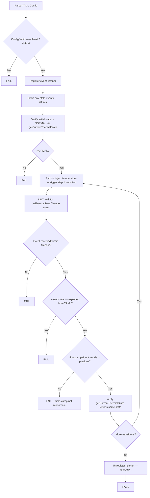
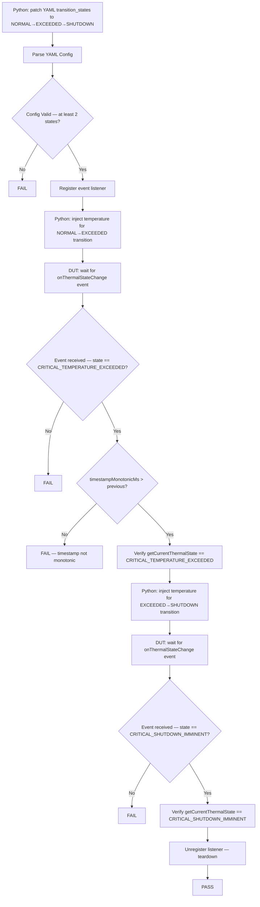

# Thermal Sensor HAL L3 Low Level Test Specification

## Table of Contents

* [Scope](#scope)
* [References](#references)
* [Acronyms, Terms and Abbreviations](#acronyms-terms-and-abbreviations)
* [Level 3 Test Procedure](#level-3-test-procedure)
* [Level 3 Test Cases Overview](#level-3-test-cases-overview)
* [Test Case Details](#test-case-details)
  * [Test 1: ThermalExceedRecoveryLifecycle](#test-1-thermalexceedrecoverylifecycle)
  * [Test 2: CriticalShutdownWithSuppression](#test-2-criticalshutdownwithsuppression)

---

## Scope

This document describes the Level 3 (L3) Low-Level Test Specification for the Thermal Sensor HAL.

L3 testing validates end-to-end Thermal Sensor HAL functionality using control-plane temperature injection. The test suite exercises:

* Thermal state transition lifecycle (NORMAL → CRITICAL_TEMPERATURE_EXCEEDED → CRITICAL_TEMPERATURE_RECOVERED → NORMAL) driven by raw temperature injections
* Monotonic timestamp ordering across consecutive `onThermalStateChange` events
* `getCurrentThermalState()` consistency with each delivered event
* Critical shutdown delivery (`CRITICAL_SHUTDOWN_IMMINENT`) and subsequent event suppression
* Listener fan-out and listener-gate semantics

L3 tests require external stimulus injected by the Python host via the UT control plane. The DUT-side VTS binary registers the listener, waits for events, and validates results; the Python host drives temperature injections via the control port.

---

## Acronyms, Terms and Abbreviations

- `HAL`    - Hardware Abstraction Layer
- `VTS`    - Vendor Test Suite
- `L1`     - Level 1 Testing
- `L2`     - Level 2 Testing
- `L3`     - Level 3 Testing
- `DUT`    - Device Under Test
- `RAFT`   - Rapid Automation Framework for Testing
- `YAML`   - YAML Ain't Markup Language
- `AIDL`   - Android Interface Definition Language
- `HFP`    - Hardware Feature Profile
- `SoC`    - System on Chip

---

## References

- High Level Test Specification — [thermal_sensor_High_Level_TestSpecification.md](thermal_sensor_High_Level_TestSpecification.md)
- L2 Test Specification — [thermal_sensor_L2_Low-Level_TestSpecification.md](thermal_sensor_L2_Low-Level_TestSpecification.md)
- L3 YAML Configuration — [test_configuration/vts_l3_ThermalSensor.yaml](../../test_configuration/vts_l3_ThermalSensor.yaml)
- HFP Profile — [profiles/hfp-thermalsensor-vcomponent.yaml](../../profiles/hfp-thermalsensor-vcomponent.yaml)
- Thermal Sensor AIDL Interfaces:
  - [IThermalSensor](https://github.com/rdkcentral/rdk-halif-aidl/blob/main/sensor/current/com/rdk/hal/sensor/thermal/IThermalSensor.aidl)
  - [IThermalEventListener](https://github.com/rdkcentral/rdk-halif-aidl/blob/main/sensor/current/com/rdk/hal/sensor/thermal/IThermalEventListener.aidl)
  - [State](https://github.com/rdkcentral/rdk-halif-aidl/blob/main/sensor/current/com/rdk/hal/sensor/thermal/State.aidl)
  - [ActionEvent](https://github.com/rdkcentral/rdk-halif-aidl/blob/main/sensor/current/com/rdk/hal/sensor/thermal/ActionEvent.aidl)
  - [TemperatureReading](https://github.com/rdkcentral/rdk-halif-aidl/blob/main/sensor/current/com/rdk/hal/sensor/thermal/TemperatureReading.aidl)

---

## Level 3 Test Procedure

The L3 Thermal Sensor test suite operates as follows:

1. Python host calls `updateTransitionStates()` to patch `thermalsensor.L3.transition_states` in the YAML config ([test_configuration/vts_l3_ThermalSensor.yaml](../../test_configuration/vts_l3_ThermalSensor.yaml)) with the test-case-specific state sequence.
2. Python host uploads the updated YAML to the DUT target directory.
3. Python host starts the DUT-side VTS binary via SSH (or triggers it within the RAFT framework).
4. DUT-side VTS parses the YAML, registers the event listener, and waits for `onThermalStateChange` events.
5. Python host injects synthetic raw temperature values via the control port to drive vendor-policy-level state transitions.
6. DUT-side VTS validates received events (state correctness, monotonic timestamp, `getCurrentThermalState()` consistency) and reports pass/fail.
7. Python host collects the result and logs it.

---

## Level 3 Test Cases Overview

| # | Test Case | Description | HAL APIs |
|---|-----------|-------------|----------|
| 1 | `ThermalExceedRecoveryLifecycle` | Validate that state transitions driven by temperature injection follow the expected sequence (`NORMAL → CRITICAL_TEMPERATURE_EXCEEDED → CRITICAL_TEMPERATURE_RECOVERED → NORMAL`), that timestamps are monotonically increasing, and that `getCurrentThermalState()` reflects each new state after its event is delivered. When the HFP profile declares multiple sensors, the test is repeated for every `(primary, secondary)` sensor permutation | `IThermalSensor::registerEventListener()`, `IThermalSensor::unregisterEventListener()`, `IThermalSensor::getCurrentThermalState()`, `IThermalEventListener::onThermalStateChange()` |
| 2 | `CriticalShutdownWithSuppression` | Validate that the HAL delivers `CRITICAL_SHUTDOWN_IMMINENT` when the shutdown threshold is breached. The Python host drives `NORMAL → CRITICAL_TEMPERATURE_EXCEEDED → CRITICAL_SHUTDOWN_IMMINENT` and verifies each event is received with a monotonically increasing timestamp and `getCurrentThermalState()` consistency | `IThermalSensor::registerEventListener()`, `IThermalSensor::unregisterEventListener()`, `IThermalSensor::getCurrentThermalState()`, `IThermalEventListener::onThermalStateChange()` |

---

## Test Case Details

---

## Test 1: ThermalExceedRecoveryLifecycle

| Title | Details |
| ----- | ------- |
| Function Name | `ThermalExceedRecoveryLifecycle` |
| Description | Validates that the HAL correctly delivers thermal state-change events for each consecutive `(from → to)` pair defined in the `transition_states` YAML sequence. Verifies initial state is `NORMAL`, event states match the configured sequence, `timestampMonotonicMs` is strictly increasing across events, and `getCurrentThermalState()` reflects each new state after delivery. When the HFP profile declares multiple sensors, the Python host repeats the full sequence for every `(primary, secondary)` sensor permutation. Before each sequence the secondary sensor is pre-warmed to a safe temperature to avoid cross-sensor interference |
| Test Group | 03 |
| Test Case ID | 001 |
| Priority | High |

### Pre-Conditions

* Thermal Sensor HAL service must be running.
* Thermal Sensor HAL service must be running with the control plane enabled.
* YAML configuration must be present at the path defined by `VTS_THERMALSENSOR_TEST_CONFIG_PATH`.
* [test_configuration/vts_l3_ThermalSensor.yaml](../../test_configuration/vts_l3_ThermalSensor.yaml) must have `ThermalExceedRecoveryLifecycle` section populated with at least 2 states.
* System must start in `NORMAL` thermal state.

### Dependencies

* Thermal Sensor HAL Interfaces: `IThermalSensor`, `IThermalEventListener`
* Python host test: `vts_thermalsensor_L3_ThermalExceedRecoveryLifecycle.py`
* UT control plane for temperature injection

### User Interaction

No

---

### Test Flow Diagram



---

### Test Procedure

| Step | Description | Test Data | Expected Result |
| ---- | ----------- | --------- | --------------- |
| 1 | Python host patches `transition_states` in `vts_l3_ThermalSensor.yaml` via `updateTransitionStates()` and uploads the file to the DUT | `transition_states: [NORMAL, CRITICAL_TEMPERATURE_EXCEEDED, CRITICAL_TEMPERATURE_RECOVERED, NORMAL]` | YAML updated and present on DUT |
| 2 | Parse YAML configuration for `ThermalExceedRecoveryLifecycle` | `vts_l3_ThermalSensor.yaml` | Config parsed; `transition_states` has ≥ 2 entries |
| 3 | Register event listener | Valid `IThermalEventListener` | `registerEventListener()` returns `true`; status OK |
| 4 | Drain any stale events | 200 ms drain window | No events received |
| 5 | Call `getCurrentThermalState()` and assert result is `NORMAL` | — | State is `NORMAL` |
| 6 | Python host pre-warms the secondary sensor to its safe temperature (`recovered_threshold − 10°C`) to avoid cross-sensor interference | Safe temperature derived from HFP thresholds | Injection accepted; no state-change event fired |
| 7 | For each consecutive `(from → to)` pair in `transition_states`: Python host injects a raw temperature value via the control port that crosses the HFP threshold for the `to` state. For a `NORMAL` transition, the secondary sensor is also reset to its safe temperature | Injection temperature derived from HFP thresholds (`exceeded + 2°C`, `recovered − 2°C`, or midpoint for `NORMAL`) | Injection accepted; triggers vendor policy transition |
| 8 | DUT-side VTS waits for `onThermalStateChange` event within `event_timeout_ms` | `event_timeout_ms` from YAML | Event received before timeout |
| 9 | Assert `event.state == toState` for the current transition | Expected `State` enum value | Event state matches the `to` state in the YAML sequence |
| 10 | Assert `event.timestampMonotonicMs > lastTimestampMs` (strictly greater than previous) | Previous and current `timestampMonotonicMs` | Timestamp is monotonically increasing |
| 11 | Call `getCurrentThermalState()` and assert it matches `event.state` | — | Reported state consistent with delivered event |
| 12 | If `event.temperatureReading` is non-null, log `sensorName` and `temperatureCelsius` | Optional `TemperatureReading` in `ActionEvent` | No assertion; informational only |
| 13 | Repeat steps 6–12 for all remaining transitions | — | All transitions pass |
| 14 | If the HFP profile declares N > 1 sensors, repeat steps 6–13 for every `(primary, secondary)` permutation (`i ≠ j`) | All sensor pairs from HFP profile | All permutations pass |
| 15 | Listener unregistered by test teardown | Controller handle | `unregisterEventListener()` returns `true` |

---

### YAML Configuration Fields

All L3 tests share a single config block at `thermalsensor.L3`. The Python host patches `transition_states` in-place (via `updateTransitionStates()`) before uploading the file to the DUT for each test case.

```yaml
thermalsensor:
  L3:
    transition_states:
      - NORMAL
      - CRITICAL_TEMPERATURE_EXCEEDED
      - CRITICAL_TEMPERATURE_RECOVERED
      - NORMAL
    event_timeout_ms: 15000
    suppression_timeout_ms: 5000
```

**State Name Mapping:**

| YAML String | `State` Enum Value |
|-------------|-------------------|
| `NORMAL` | `State::NORMAL` |
| `CRITICAL_TEMPERATURE_EXCEEDED` | `State::CRITICAL_TEMPERATURE_EXCEEDED` |
| `CRITICAL_TEMPERATURE_RECOVERED` | `State::CRITICAL_TEMPERATURE_RECOVERED` |
| `CRITICAL_SHUTDOWN_IMMINENT` | `State::CRITICAL_SHUTDOWN_IMMINENT` |

---

## Test 2: CriticalShutdownWithSuppression

| Title | Details |
| ----- | ------- |
| Function Name | `CriticalShutdownWithSuppression` |
| Description | Validates that the HAL delivers thermal state-change events correctly up to and including `CRITICAL_SHUTDOWN_IMMINENT`. The Python host drives `NORMAL → CRITICAL_TEMPERATURE_EXCEEDED → CRITICAL_SHUTDOWN_IMMINENT` and verifies each event is received, timestamps are monotonically increasing, and `getCurrentThermalState()` is consistent with each delivered event. Post-shutdown recovery verification (`_verifyShutdownAndRecovery`) is a planned future extension (currently a stub) |
| Test Group | 03 |
| Test Case ID | 002 |
| Priority | High |

### Pre-Conditions

* Thermal Sensor HAL service must be running.
* Thermal Sensor HAL service must be running with the control plane enabled.
* YAML configuration must be present at the path defined by `VTS_THERMALSENSOR_TEST_CONFIG_PATH`.
* [test_configuration/vts_l3_ThermalSensor.yaml](../../test_configuration/vts_l3_ThermalSensor.yaml) must have a valid `thermalsensor.L3` config block. The Python host patches `transition_states` to `[NORMAL, CRITICAL_TEMPERATURE_EXCEEDED, CRITICAL_SHUTDOWN_IMMINENT]` before running this test.
* System must start in `NORMAL` thermal state.

### Dependencies

* Thermal Sensor HAL Interfaces: `IThermalSensor`, `IThermalEventListener`
* Python host test: `vts_thermalsensor_L3_CriticalShutdownWithSuppression.py`
* UT control plane for temperature injection

### User Interaction

No

---

### Test Flow Diagram



---

### Test Procedure

| Step | Description | Test Data | Expected Result |
| ---- | ----------- | --------- | --------------- |
| 1 | Python host patches `transition_states` in `vts_l3_ThermalSensor.yaml` to `[NORMAL, CRITICAL_TEMPERATURE_EXCEEDED, CRITICAL_SHUTDOWN_IMMINENT]` via `updateTransitionStates()` and uploads the file to the DUT | `vts_l3_ThermalSensor.yaml` | YAML updated and present on DUT |
| 2 | Parse YAML configuration for `CriticalShutdownWithSuppression` | `vts_l3_ThermalSensor.yaml` | Config parsed; `transition_states` contains at least 2 entries |
| 3 | Register event listener | Valid `IThermalEventListener` | `registerEventListener()` returns `true`; status OK |
| 4 | Python host injects a temperature above `critical_temperature_exceeded_celsius` to trigger `NORMAL → CRITICAL_TEMPERATURE_EXCEEDED` | `exceeded_threshold + 2°C` from HFP | Event received; `event.state == CRITICAL_TEMPERATURE_EXCEEDED`; `timestampMonotonicMs > 0` |
| 5 | Call `getCurrentThermalState()` and assert `CRITICAL_TEMPERATURE_EXCEEDED` | — | State confirmed as `CRITICAL_TEMPERATURE_EXCEEDED` |
| 6 | Python host injects a temperature above `entering_critical_shutdown_celsius` to trigger `CRITICAL_TEMPERATURE_EXCEEDED → CRITICAL_SHUTDOWN_IMMINENT` | `shutdown_threshold + 2°C` from HFP | Event received; `event.state == CRITICAL_SHUTDOWN_IMMINENT`; `timestampMonotonicMs > previous` |
| 7 | Call `getCurrentThermalState()` and assert `CRITICAL_SHUTDOWN_IMMINENT` | — | State confirmed as `CRITICAL_SHUTDOWN_IMMINENT` |
| 8 | Listener unregistered by test teardown | Controller handle | `unregisterEventListener()` returns `true` |

> **Note:** Post-shutdown recovery verification (ping-test, cooldown wait, boot-reason check via `IBoot.getBootReason()`) is a planned future extension tracked in `_verifyShutdownAndRecovery()`. It is not exercised in the current test run.

---

### YAML Configuration Fields

The Python host patches the shared `thermalsensor.L3` block before running TC2. The `transition_states` are overwritten to the fixed 3-state shutdown sequence:

```yaml
thermalsensor:
  L3:
    transition_states:
      - NORMAL
      - CRITICAL_TEMPERATURE_EXCEEDED
      - CRITICAL_SHUTDOWN_IMMINENT
    event_timeout_ms: 15000
    suppression_timeout_ms: 5000
```

**Note on `suppression_timeout_ms`:** Parsed from YAML for future use by `_verifyShutdownAndRecovery()`. Not consumed by the current TC2 C++ test body since no post-shutdown states appear in the patched sequence.
