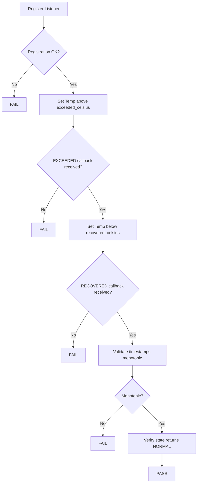
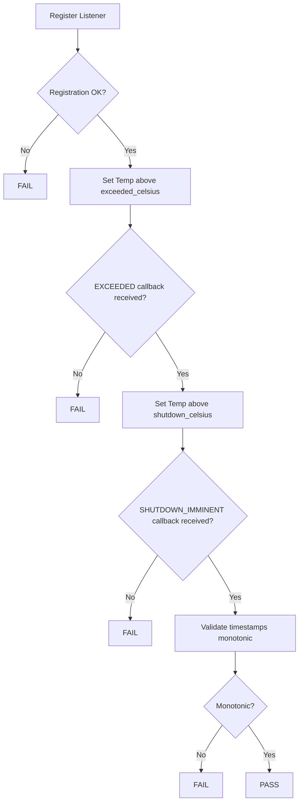
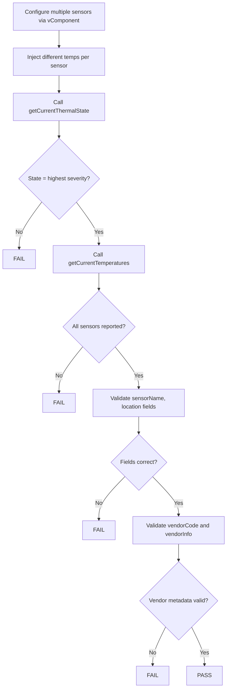
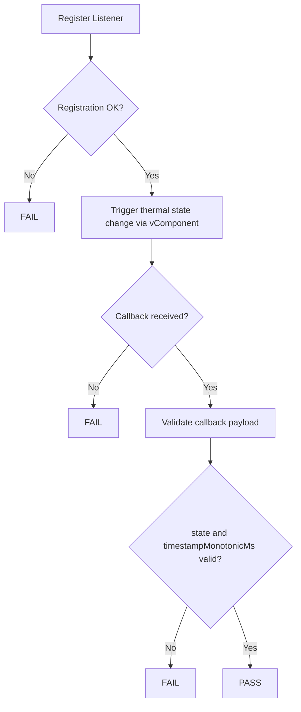
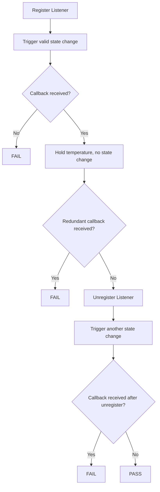

# Thermal Sensor HAL L3 Low Level Test Specification and Procedure Documentation

## Table of Contents

* [Scope](#scope)
* [Level 3 Test Procedure](#level-3-test-procedure)
* [Level 3 Test Cases Overview](#level-3-test-cases-overview)

---

## Scope

This document describes the Level 3 (L3) Low Level Test Specification for the Thermal Sensor HAL.

L3 testing validates end-to-end Thermal Sensor HAL functionality using real device operations, including:

* Thermal state lifecycle transitions (NORMAL → EXCEEDED → RECOVERED)
* Critical shutdown trigger behavior
* Multi-sensor telemetry aggregation and reporting
* Event callback delivery validation
* Listener lifecycle management and no-redundant-callback enforcement

---

## Level 3 Test Procedure

The L3 Thermal Sensor test suite performs:

1. YAML configuration parsing (thermal thresholds and policy)
2. Registration of listener interfaces on the DUT
3. Execution of Thermal Sensor HAL APIs via UT framework
4. Environmental/simulated temperature manipulation via vComponent
5. Monitoring thermal state transitions and event callbacks
6. Validation of reported states, timestamps, and telemetry fields

---

## Level 3 Test Cases Overview

| Test Case                              | Description                                                                    | HAL APIs                                                         |
| -------------------------------------- | ------------------------------------------------------------------------------ | ---------------------------------------------------------------- |
| thermal_exceedAndRecoveryLifecycle     | Validate NORMAL → EXCEEDED → RECOVERED → NORMAL state lifecycle                | `registerEventListener()`, `getCurrentThermalState()`, `onThermalStateChange()` |
| thermal_criticalShutdownTrigger        | Validate NORMAL → EXCEEDED → SHUTDOWN transition and controlled shutdown       | `registerEventListener()`, `getCurrentThermalState()`, `onThermalStateChange()` |
| thermal_multiSensorAggregationTelemetry| Validate multi-sensor thermal state aggregation, reporting, and telemetry      | `getCurrentThermalState()`, `getCurrentTemperatures()`           |
| thermal_eventCallbackDelivery          | Validate asynchronous callback delivery on thermal state transitions           | `registerEventListener()`, `onThermalStateChange()`              |
| thermal_listenerLifecycleNoRedundant   | Validate callback delivery only while registered and no redundant callbacks    | `registerEventListener()`, `unregisterEventListener()`, `onThermalStateChange()` |

---

# Test Case Details

---

## Test 1: thermal_exceedAndRecoveryLifecycle

| Title         | Details                                                                                         |
| ------------- | ----------------------------------------------------------------------------------------------- |
| Function Name | `thermal_exceedAndRecoveryLifecycle`                                                            |
| Description   | Validates full thermal lifecycle: NORMAL → CRITICAL_TEMPERATURE_EXCEEDED → CRITICAL_TEMPERATURE_RECOVERED → NORMAL, including monotonic timestamp ordering |
| Test Group    | 03                                                                                              |
| Test Case ID  | 001                                                                                             |
| Priority      | High                                                                                            |

### Pre-Conditions

* Thermal Sensor HAL service must be running
* Listener interface must be registered before temperature manipulation
* YAML thermal configuration must define valid `critical_temperature_exceeded_celsius` and `critical_temperature_recovered_celsius` thresholds
* vComponent must support simulated temperature injection

### Dependencies

* Thermal Sensor HAL Interface: `IThermalSensor`, `IThermalSensorListener`
* YAML Configuration: thermal policy thresholds
* UT Framework
* vComponent for temperature simulation

### User Interaction

No

---

### Test Flow Diagram

---

### Test Procedure

| Step | Description                                    | Test Data                       | Expected Result                                              |
| ---- | ---------------------------------------------- | ------------------------------- | ------------------------------------------------------------ |
| 1    | Register thermal event listener                | Valid listener instance         | Registration succeeds                                        |
| 2    | Inject temperature above `exceeded_celsius`    | temp > exceeded threshold       | `onThermalStateChange` fires with `CRITICAL_TEMPERATURE_EXCEEDED` |
| 3    | Record timestamp from EXCEEDED event           | `timestampMonotonicMs`          | Timestamp captured                                           |
| 4    | Inject temperature below `recovered_celsius`   | temp < recovered threshold      | `onThermalStateChange` fires with `CRITICAL_TEMPERATURE_RECOVERED` |
| 5    | Record timestamp from RECOVERED event          | `timestampMonotonicMs`          | Timestamp is greater than EXCEEDED timestamp                 |
| 6    | Allow cooldown per recovery policy             | Policy timer                    | State transitions back to `NORMAL`                           |
| 7    | Call `getCurrentThermalState()`                | N/A                             | Returns `NORMAL`                                             |
| 8    | Validate monotonic timestamp ordering          | All captured timestamps         | Each successive timestamp is greater than the previous       |

---

## Test 2: thermal_criticalShutdownTrigger

| Title         | Details                                                                                         |
| ------------- | ----------------------------------------------------------------------------------------------- |
| Function Name | `thermal_criticalShutdownTrigger`                                                               |
| Description   | Validates device transitions NORMAL → CRITICAL_TEMPERATURE_EXCEEDED → CRITICAL_SHUTDOWN_IMMINENT and initiates controlled shutdown, with monotonic timestamps across events |
| Test Group    | 03                                                                                              |
| Test Case ID  | 002                                                                                             |
| Priority      | High                                                                                            |

### Pre-Conditions

* Thermal Sensor HAL service must be running
* Listener interface must be registered before temperature manipulation
* YAML thermal configuration must define valid `entering_critical_shutdown_celsius` threshold
* vComponent must support simulated temperature injection
* DUT environment must allow safe simulation of shutdown trigger (may require sandbox)

### Dependencies

* Thermal Sensor HAL Interface: `IThermalSensor`, `IThermalSensorListener`
* YAML Configuration: shutdown threshold policy
* UT Framework
* vComponent for temperature simulation

### User Interaction

No

---

### Test Flow Diagram

---

### Test Procedure

| Step | Description                                     | Test Data                       | Expected Result                                                |
| ---- | ----------------------------------------------- | ------------------------------- | -------------------------------------------------------------- |
| 1    | Register thermal event listener                 | Valid listener instance         | Registration succeeds                                          |
| 2    | Inject temperature above `exceeded_celsius`     | temp > exceeded threshold       | `onThermalStateChange` fires with `CRITICAL_TEMPERATURE_EXCEEDED` |
| 3    | Record timestamp from EXCEEDED event            | `timestampMonotonicMs`          | Timestamp captured                                             |
| 4    | Inject temperature above `shutdown_celsius`     | temp > shutdown threshold       | `onThermalStateChange` fires with `CRITICAL_SHUTDOWN_IMMINENT` |
| 5    | Record timestamp from SHUTDOWN event            | `timestampMonotonicMs`          | Timestamp is greater than EXCEEDED timestamp                   |
| 6    | Validate HAL initiates controlled shutdown      | N/A                             | Controlled shutdown initiated by HAL                           |
| 7    | Validate monotonic timestamp ordering           | All captured timestamps         | Each successive timestamp is greater than the previous         |

---

## Test 3: thermal_multiSensorAggregationTelemetry

| Title         | Details                                                                                         |
| ------------- | ----------------------------------------------------------------------------------------------- |
| Function Name | `thermal_multiSensorAggregationTelemetry`                                                       |
| Description   | Validates multi-sensor thermal state aggregation and telemetry: all sensors reported with correct identifiers, temperature readings accurate and consistent, and aggregated state reflects highest severity |
| Test Group    | 03                                                                                              |
| Test Case ID  | 003                                                                                             |
| Priority      | High                                                                                            |

### Pre-Conditions

* Thermal Sensor HAL service must be running
* At least two sensor sources (e.g., SoC, Board) must be configured via vComponent
* YAML configuration must include per-sensor identifiers, thresholds, and vendor metadata

### Dependencies

* Thermal Sensor HAL Interface: `IThermalSensor`
* YAML Configuration: multi-sensor policy
* UT Framework
* vComponent for multi-sensor simulation

### User Interaction

No

---

### Test Flow Diagram

---

### Test Procedure

| Step | Description                                     | Test Data                                | Expected Result                                                   |
| ---- | ----------------------------------------------- | ---------------------------------------- | ----------------------------------------------------------------- |
| 1    | Configure SoC sensor at NORMAL temperature      | temp < exceeded threshold                | Sensor reports NORMAL                                             |
| 2    | Configure Board sensor above `exceeded_celsius` | temp > exceeded threshold                | Sensor reports CRITICAL_TEMPERATURE_EXCEEDED                      |
| 3    | Call `getCurrentThermalState()`                 | N/A                                      | Returns `CRITICAL_TEMPERATURE_EXCEEDED` (highest severity)        |
| 4    | Call `getCurrentTemperatures()`                 | N/A                                      | Returns array with one entry per active sensor                    |
| 5    | Validate `sensorName` for each record           | Configured sensor names                  | Each record's `sensorName` matches configured identifier          |
| 6    | Validate `location` for each record             | Configured sensor locations              | Each record's `location` matches configured identifier            |
| 7    | Validate `temperatureCelsius` accuracy          | Injected temperature values              | Readings match injected values within tolerance                   |
| 8    | Validate `timestampMonotonicMs`                 | N/A                                      | Non-zero monotonic timestamp                                      |
| 9    | Validate `vendorCode` and `vendorInfo`          | Configured vendor metadata               | Values match YAML; `vendorInfo` may be null without failure       |

---

## Test 4: thermal_eventCallbackDelivery

| Title         | Details                                                                                           |
| ------------- | ------------------------------------------------------------------------------------------------- |
| Function Name | `thermal_eventCallbackDelivery`                                                                   |
| Description   | Validates that the registered listener receives asynchronous callbacks when thermal state transitions occur |
| Test Group    | 03                                                                                                |
| Test Case ID  | 004                                                                                               |
| Priority      | High                                                                                              |

### Pre-Conditions

* Thermal Sensor HAL service must be running
* Listener must be registered before temperature is manipulated
* vComponent must support simulated temperature injection

### Dependencies

* Thermal Sensor HAL Interface: `IThermalSensor`, `IThermalSensorListener`
* UT Framework
* vComponent for temperature simulation

### User Interaction

No

---

### Test Flow Diagram

---

### Test Procedure

| Step | Description                                       | Test Data                  | Expected Result                                       |
| ---- | ------------------------------------------------- | -------------------------- | ----------------------------------------------------- |
| 1    | Register thermal event listener                   | Valid listener instance     | Registration succeeds                                 |
| 2    | Inject temperature to trigger state change        | temp > exceeded threshold   | Thermal transition initiated                          |
| 3    | Wait for asynchronous callback within timeout     | Timeout value               | `onThermalStateChange` callback received              |
| 4    | Validate `state` field in callback payload        | Valid enum value            | State is a valid `ThermalState` enum                  |
| 5    | Validate `timestampMonotonicMs` in payload        | Non-zero monotonic value    | Timestamp is non-zero and monotonic                   |
| 6    | Validate `temperatureReading` in payload          | May be null                 | Field present; null is acceptable per spec            |

---

## Test 5: thermal_listenerLifecycleNoRedundant

| Title         | Details                                                                                                  |
| ------------- | -------------------------------------------------------------------------------------------------------- |
| Function Name | `thermal_listenerLifecycleNoRedundant`                                                                   |
| Description   | Validates callbacks are received only for valid state changes while registered, no redundant callbacks are triggered without state change, and no callbacks are received after unregister |
| Test Group    | 03                                                                                                       |
| Test Case ID  | 005                                                                                                      |
| Priority      | High                                                                                                     |

### Pre-Conditions

* Thermal Sensor HAL service must be running
* vComponent must support simulated temperature injection and stable-temperature hold

### Dependencies

* Thermal Sensor HAL Interface: `IThermalSensor`, `IThermalSensorListener`
* UT Framework
* vComponent for temperature simulation

### User Interaction

No

---

### Test Flow Diagram

---

### Test Procedure

| Step | Description                                              | Test Data                  | Expected Result                                              |
| ---- | -------------------------------------------------------- | -------------------------- | ------------------------------------------------------------ |
| 1    | Register thermal event listener                          | Valid listener instance     | Registration succeeds                                        |
| 2    | Trigger a valid thermal state transition                 | temp > exceeded threshold   | `onThermalStateChange` callback received                     |
| 3    | Hold temperature within the same range (no state change) | Stable temperature          | No additional callback received                              |
| 4    | Unregister the listener                                  | Registered listener         | Unregistration succeeds                                      |
| 5    | Trigger another thermal state transition                 | temp change                 | No callback received (listener unregistered)                 |
| 6    | Confirm callback count after unregister                  | Callback counter            | Count unchanged since unregistration                         |

---

## References

* Thermal Sensor HAL High Level Test Specification: [thermal_sensor_High-Level_TestSpecification.md](thermal_sensor_High-Level_TestSpecification.md)
* Thermal Sensor HAL Interface: `IThermalSensor`, `IThermalSensorListener`
* YAML thermal policy configuration

---
