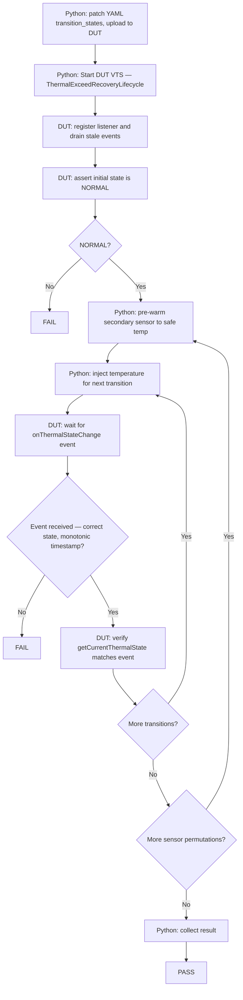
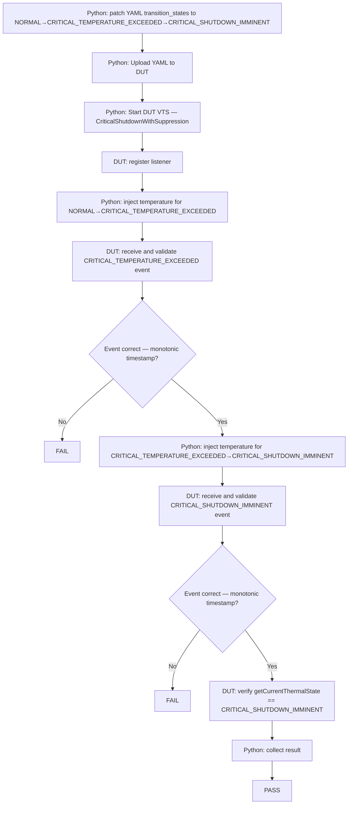

# Thermal Sensor HAL L1, L2, L3 Test Procedure

## Table of Contents

* [Acronyms, Terms and Abbreviations](#acronyms-terms-and-abbreviations)
* [Build the VTS](#build-the-vts)
  * [Build Linux Binder](#build-linux-binder)
  * [Build Thermal Sensor VTS Binaries](#build-thermal-sensor-vts-binaries)
  * [Environment Variables](#environment-variables)
  * [Build](#build)
* [Run L1 L2 Tests Without Python](#run-l1-l2-tests-without-python)
  * [Transfer Tar File to Target Device](#transfer-tar-file-to-target-device)
  * [Extract on Target Device](#extract-on-target-device)
  * [Run the VTS Test on Target Device](#run-the-vts-test-on-target-device)
* [Run Tests in Python Environment](#run-tests-in-python-environment)
  * [Update Configuration Files](#update-configuration-files)
  * [Install Python Packages](#install-python-packages)
  * [Run Test Cases](#run-test-cases)
* [L3 Test Cases](#l3-test-cases)
  * [L3 Test 1 — ThermalExceedRecoveryLifecycle](#l3-test-1--thermalexceedrecoverylifecycle)
  * [L3 Test 2 — CriticalShutdownWithSuppression](#l3-test-2--criticalshutdownwithsuppression)
* [Notes](#notes)

---

## Acronyms, Terms and Abbreviations

* `HAL`   - Hardware Abstraction Layer
* `VTS`   - Vendor Test Suite
* `L1`    - Level 1 Testing
* `L2`    - Level 2 Testing
* `L3`    - Level 3 Testing
* `DUT`   - Device Under Test
* `RAFT`  - Rapid Automation Framework for Testing
* `YAML`  - YAML Ain't Markup Language
* `AIDL`  - Android Interface Definition Language
* `HFP`   - Hardware Feature Profile
* `SSH`   - Secure Shell
* `SoC`   - System on Chip

---

## Build the VTS

### Build Linux Binder

The test suite depends on Linux binder with `AIDL` support.

For detailed instructions, refer to: [Linux Binder](https://github.com/rdkcentral/linux_binder_idl/tree/1.0.0)

```bash
git clone -b develop 'https://github.com/rdkcentral/linux_binder_idl.git'
cd linux_binder_idl
./build-linux-binder-aidl.sh 64
```

---

### Build Thermal Sensor VTS Binaries

Clone and build the Thermal Sensor test suite:

```bash
git clone git@github.com:rdkcentral/rdk-halif-aidl-test-thermal-sensor.git
cd rdk-halif-aidl-test-thermal-sensor
```

---

### Environment Variables

Set the following environment variables before building:

- `AIDL_BIN`: Path to the AIDL compiler.
- `LINUX_BINDER_OUT_DIR`: Path to the Linux binder output directory.
- `UT_CORE_VERSION`: UT-Core version (optional; defaults to latest tag).
- `RDK_HALIF_AIDL_VERSION`: AIDL HAL spec version (optional; defaults to latest HEAD).

Example:

```bash
export UT_CORE_VERSION=5.0.0
export RDK_HALIF_AIDL_VERSION=0.15.0
export AIDL_BIN=/path/to/linux_binder_idl/out/aidl
export LINUX_BINDER_OUT_DIR=/path/to/linux_binder_idl/local/
```

Enable UT logs (optional):

```bash
export ENABLE_UT_INFO_LOGGING=1
```

---

### Build

```bash
./build.sh Target=<Target-name>

# Supported Targets: linux, arm
```

Build output:
- Binaries under `build/bin/`
- Tarball `vts-thermalsensor.tar.gz` under `build/bin/`

---

## Run L1 L2 Tests Without Python

### Transfer Tar File to Target Device

```bash
scp -P <port> build/bin/vts-thermalsensor.tar.gz root@<DUT>:/tmp/
```

### Extract on Target Device

```bash
ssh root@<DUT>
mkdir -p /tmp/thermalsensor
tar -zxf /tmp/vts-thermalsensor.tar.gz -C /tmp/thermalsensor
cd /tmp/thermalsensor
```

### Run the VTS Test on Target Device

```bash
./run.sh -p profiles/hfp-thermalsensor-vcomponent.yaml
```

---

## Run Tests in Python Environment

### Update Configuration Files

#### Rack Configuration File

Example: [host/configs/vts_rack_configuration.yaml](../../host/configs/vts_rack_configuration.yaml)


| Console Session | Description |
|----------------|-------------|
| `default` | Device status and basic operations |
| `ssh_hal_test_0` | Executes Thermal Sensor HAL VTS binary on DUT |
| `ssh_hal_test_1` | Second SSH session for HAL service control |

```yaml
rackConfig:
  rack1:
    name: "rack1"
    slot1:
      name: "slot1"
      devices:
        - dut:
            ip: ""
            platform: "vDevice"
            consoles:
              - default:
                  type: "ssh"
                  port: <port>
                  username: "root"
                  ip: ""
                  password: ""
                  prompt: "~#"
              - ssh_hal_test_0:
                  type: "ssh"
                  port: <port>
                  username: "root"
                  ip: ""
                  password: ""
                  prompt: "~#"
              - ssh_hal_test_1:
                  type: "ssh"
                  port: <port>
                  username: "root"
                  ip: ""
                  password: ""
                  prompt: "~#"
            outbound:
              download_url: "tftp://tftp-server.com/rack1/slot1/"
              upload_url: "sftp://server-address/home/workspace/tftp/rack1/slot1/"
              workspaceDirectory: "./logs/workspace"
```
---

#### Device Configuration File

Example: [host/configs/vts_device_configuration.yaml](../../host/configs/vts_device_configuration.yaml)

```yaml
deviceConfig:
  cpe1:
    platform: "vDevice"
    model: "VTV"
    soc_vendor: "intel"
    target_directory: "/tmp/"
    prompt: "~#"
    wait_time: 240
    test:
      profile: "../../profiles/hfp-thermalsensor-vcomponent.yaml"
      thermalsensor_controller_port: 8080
```

---

### Install Python Packages

From `host/`:

```bash
./install.sh
source activate_venv.sh
./install.sh
```

---

### Run Test Cases

#### L1 and L2 Tests

```bash
python host/tests/vts_thermalsensor_L1_L2_tests.py \
  --config </PATH>/host/configs/vts_rack_configuration.yaml \
  --deviceConfig </PATH>/host/configs/vts_device_configuration.yaml
```

---

#### L3 Tests

```bash
python host/tests/<L3-test-case>.py \
  --config </PATH>/host/configs/vts_rack_configuration.yaml \
  --deviceConfig </PATH>/host/configs/vts_device_configuration.yaml
```

---

## L3 Test Cases

### L3 Test 1 — ThermalExceedRecoveryLifecycle

#### Purpose

Validates end-to-end thermal state transition lifecycle driven by raw temperature injections. Confirms that `onThermalStateChange` events are delivered for each configured transition (`NORMAL → CRITICAL_TEMPERATURE_EXCEEDED → CRITICAL_TEMPERATURE_RECOVERED → NORMAL`), that timestamps are monotonically increasing, and that `getCurrentThermalState()` is consistent with each delivered event.

When the HFP profile declares N > 1 sensors, the test runs for every `(primary, secondary)` sensor permutation (`i ≠ j`). Before each sequence, the secondary sensor is pre-warmed to a safe temperature (`recovered_threshold − 10°C`) to avoid cross-sensor interference. For a single-sensor profile the sensor is used as both primary and secondary.

---

#### Test Flow



---

#### Test Steps (Python Host Side)

1. Patch `thermalsensor.L3.transition_states` in `vts_l3_ThermalSensor.yaml` to `[NORMAL, CRITICAL_TEMPERATURE_EXCEEDED, CRITICAL_TEMPERATURE_RECOVERED, NORMAL]` via `updateTransitionStates()`.
2. Upload updated YAML to DUT target directory.
3. Execute `ThermalExceedRecoveryLifecycle` test case on DUT via SSH.
4. Pre-warm the secondary sensor to its safe temperature (`recovered_threshold − 10°C`).
5. For each `(from → to)` pair in `transition_states`: inject a temperature value via the control port that crosses the HFP threshold for the `to` state (`exceeded + 2°C`, `recovered − 2°C`, or `(recovered + exceeded) / 2` for `NORMAL`). For a `NORMAL` transition also reset the secondary sensor to its safe temperature.
6. If the HFP profile has N > 1 sensors, repeat steps 4–5 for every `(primary, secondary)` permutation where `i ≠ j`.
7. Collect DUT output and validate pass/fail result.

---

#### Expected Results

| Condition | Expected |
|-----------|----------|
| Initial state | `getCurrentThermalState()` returns `NORMAL` |
| Each temperature injection crosses a policy threshold | `onThermalStateChange` fired with the correct `State` enum value |
| Timestamp ordering | `timestampMonotonicMs` strictly increases across consecutive events |
| State consistency | `getCurrentThermalState()` matches `event.state` immediately after event delivery |
| Multi-sensor | All `(primary, secondary)` permutations pass independently |

---

### L3 Test 2 — CriticalShutdownWithSuppression

#### Purpose

Validates that the HAL correctly delivers `CRITICAL_SHUTDOWN_IMMINENT` upon shutdown threshold breach. The Python host drives `NORMAL → CRITICAL_TEMPERATURE_EXCEEDED → CRITICAL_SHUTDOWN_IMMINENT` and verifies each event is received, timestamps are monotonically increasing, and `getCurrentThermalState()` is consistent with each delivered event.

> **Note:** Post-shutdown recovery verification (ping-test, cooldown wait, and boot-reason check via `IBoot.getBootReason()`) is a planned future extension tracked in `_verifyShutdownAndRecovery()` and is **not** exercised in the current test run.

---

#### Test Flow



---

#### Test Steps (Python Host Side)

1. Patch `thermalsensor.L3.transition_states` in `vts_l3_ThermalSensor.yaml` to `[NORMAL, CRITICAL_TEMPERATURE_EXCEEDED, CRITICAL_SHUTDOWN_IMMINENT]` via `updateTransitionStates()`.
2. Upload updated YAML to DUT.
3. Execute `CriticalShutdownWithSuppression` on DUT.
4. Inject a temperature above `critical_temperature_exceeded_celsius` (`exceeded_threshold + 2°C`) for the `NORMAL → CRITICAL_TEMPERATURE_EXCEEDED` step; wait for event.
5. Inject a temperature above `entering_critical_shutdown_celsius` (`shutdown_threshold + 2°C`) for the `CRITICAL_TEMPERATURE_EXCEEDED → CRITICAL_SHUTDOWN_IMMINENT` step; wait for event (2× `INTER_PHASE_DELAY_S`).
6. Validate DUT reports: both events received correctly; `getCurrentThermalState()` returns `CRITICAL_SHUTDOWN_IMMINENT` after the final event.

---

#### Expected Results

| Phase | Condition | Expected |
|-------|-----------|----------|
| NORMAL → CRITICAL_TEMPERATURE_EXCEEDED | Temperature injection crosses `critical_temperature_exceeded_celsius` | `onThermalStateChange` fired with `CRITICAL_TEMPERATURE_EXCEEDED`; `timestampMonotonicMs > 0` |
| CRITICAL_TEMPERATURE_EXCEEDED → CRITICAL_SHUTDOWN_IMMINENT | Temperature injection crosses `entering_critical_shutdown_celsius` | `onThermalStateChange` fired with `CRITICAL_SHUTDOWN_IMMINENT`; `timestampMonotonicMs` strictly greater than previous |
| After CRITICAL_SHUTDOWN_IMMINENT | `getCurrentThermalState()` call | Returns `CRITICAL_SHUTDOWN_IMMINENT` |

---

## Notes

### Simulator Mode

When testing with the Thermal Sensor HAL simulator, temperature injections are performed synthetically via the control plane (HTTP port `8080` by default). The simulator emulates the vendor thermal policy engine including:

- Per-sensor temperature updates driven by raw Celsius values from the control port
- Policy evaluation: comparing injected temperature against HFP-defined thresholds (`critical_temperature_recovered_celsius`, `critical_temperature_exceeded_celsius`, `entering_critical_shutdown_celsius`)
- Automatic `onThermalStateChange` event generation when thresholds are crossed
- Shutdown suppression: once `CRITICAL_SHUTDOWN_IMMINENT` is emitted, subsequent threshold crossings are silently ignored

No physical thermal hardware or external heat source is required.

---

### Actual Hardware Mode

For real hardware testing:

- Ensure the vendor thermal policy service is running on the DUT.
- L3 temperature injection steps require a physical mechanism to drive the SoC or board temperature above the configured thresholds (e.g., CPU stress tools, environmental chamber, or controllable heater). The RAFT framework does not provide a built-in physical thermal controller; coordinate injection timing manually or via a custom controller plugin.

---

### Hardware Feature Profile (HFP)

The HFP file [profiles/hfp-thermalsensor-vcomponent.yaml](../../profiles/hfp-thermalsensor-vcomponent.yaml) defines platform-specific sensor capabilities and policy thresholds. Example:

```yaml
sensor:
  thermal:
    - id: "soc_die"
      sensorName: "SoC Die"
      location: "CPU"
      sensor_reading_range_celsius:
        min: -40
        max: 125
      operational_temperature_celsius:
        min: -20
        max: 95
      triggers:
        critical_temperature_recovered_celsius: 90
        critical_temperature_exceeded_celsius: 98
        entering_critical_shutdown_celsius: 115
      vendor:
        vendorCode: 1001
        vendorInfo: "Primary die sensor used for critical trip points."
```

Update this file to match your platform's actual sensor characteristics and policy thresholds before running any tests.

---

### L3 Test Configuration File

[test_configuration/vts_l3_ThermalSensor.yaml](../../test_configuration/vts_l3_ThermalSensor.yaml)

This file is updated dynamically by the Python host before each L3 test run. Key fields overwritten per test execution are noted in the per-test YAML sections above.

```yaml
thermalsensor:
  L3:
    transition_states:
      - NORMAL
      - CRITICAL_TEMPERATURE_EXCEEDED
      - CRITICAL_TEMPERATURE_RECOVERED
      - NORMAL
    event_timeout_ms: 15000
    suppression_timeout_ms: 5000
```

---

### Test Setup on vDevice

To validate automation on vDevice, create a password for the root user:

```bash
passwd root
```

Then update the same password in the `vts_rack_configuration.yaml` file.

> **Note:** The Python `paramiko` library does not support empty passwords on vDevice, so setting a password is required.

---

### Run on Windows Environment

To run the Python environment tests on Windows:

1. Install the Python environment and update the rack configuration files as in the Linux environment.

2. Move the entire project folder (including `host/`) to the Windows machine.

3. Open `framework/plugins/ut_raft/interactive_shell.py` and comment out or remove the following imports to avoid errors on Windows:
   ```python
   import pty
   import fcntl
   ```

4. After these changes, run the test cases using Python on the Windows system.
